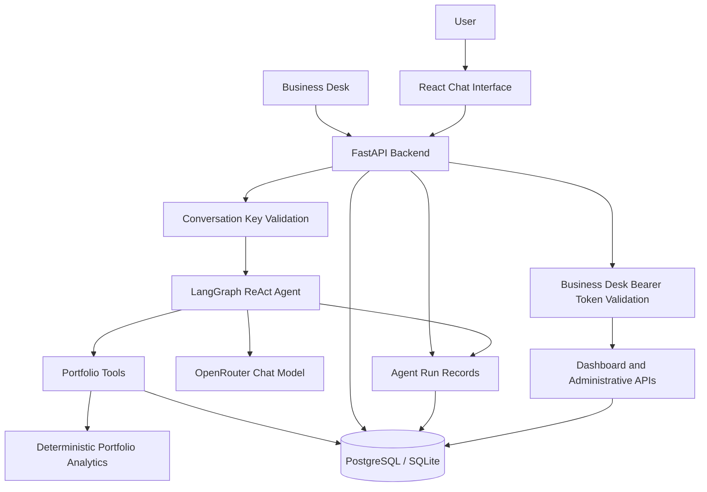

# Architecture

## Overview

Portfly is an AI-powered real estate portfolio analyst built around a React frontend, a FastAPI backend, a LangGraph ReAct agent, deterministic portfolio tools, and persistent database storage.

The system separates natural-language interpretation from portfolio calculations. The language model interprets requests and selects tools, while backend functions retrieve property records and perform calculations.

## System Architecture



The diagram represents the main components and security boundaries. Individual API endpoints have different access-control requirements.

## Request Lifecycle

### Chat and Agent Execution

1. The React chat interface sends a request to `POST /api/chat`.
2. The backend validates the user and request parameters.
3. For a new conversation, the backend generates a cryptographically random access key, stores its SHA-256 hash, and returns the plaintext key once.
4. For an existing conversation, the client supplies the conversation's key using the `X-Conversation-Key` request header.
5. The backend authorizes access before writing the new message to an existing conversation.
6. The user's message is persisted before the agent executes.
7. LangGraph runs the agent using the configured OpenRouter model when inference is available.
8. The agent can call supported portfolio tools to retrieve records, calculate metrics, or perform permitted updates.
9. The assistant response and execution information are persisted and returned to the client.

### Business Desk Execution

1. An operator opens the Business Desk.
2. The frontend uses the configured desk credential when calling protected administrative endpoints.
3. FastAPI validates the `Authorization: Bearer <DESK_TOKEN>` header.
4. Authorized requests can retrieve dashboard metrics, conversation details, execution records, and attention flags.
5. The resolution endpoint can clear a conversation's attention flag.

If `DESK_TOKEN` is missing, protected Business Desk endpoints fail closed with HTTP 503. Missing or invalid credentials return HTTP 401.

## Authentication and Access Control

Portfly uses separate mechanisms for administrative APIs and individual conversations.

### Business Desk Token

Protected administrative endpoints require a Bearer token matching the server-side `DESK_TOKEN` setting.

```http
Authorization: Bearer <DESK_TOKEN>
```

The token is compared using a constant-time comparison. The desk token is independent of conversation access keys.

### Conversation Access Keys

Every new conversation receives its own random access key.

- The backend generates the key using a cryptographically secure random generator.
- Only the SHA-256 hash is stored in the database.
- The plaintext key is returned when the conversation is created.
- Clients send the key through the `X-Conversation-Key` header when continuing a conversation or retrieving its chat history.
- Missing keys return HTTP 401.
- Invalid keys and inaccessible conversations return HTTP 403 with a generic error response.

The generic rejection behavior reduces the ability to probe conversation IDs. Chat-history responses use `Cache-Control: no-store`.

A conversation key grants access to the conversation associated with that key. It does not grant Business Desk access.

### Route-Level Protection

Authorization is enforced by the backend rather than relying exclusively on frontend controls. The current implementation protects the dashboard and administrative conversation endpoints with the desk token, and existing-conversation operations with conversation keys.

The user and property listing routes must be assessed separately because they do not all use the same authentication dependency. They should be protected appropriately before exposing sensitive production data.

## Agent and Tool Design

### LangGraph ReAct Agent

The agent uses a configured OpenRouter chat model and a set of backend tools. It interprets natural-language questions, selects tools, and composes responses from their results.

The model identifier is controlled through `OPENROUTER_MODEL`, and the provider endpoint through `OPENROUTER_BASE_URL`.

### Deterministic Portfolio Tools

Portfolio operations are delegated to backend functions rather than allowing the model to calculate financial totals from memory.

Supported operations include portfolio queries, property filtering, financial calculations, and permitted property updates.

The exact operations available to the agent are determined by the registered tools in the backend implementation.

### Hypothetical Scenarios

Hypothetical portfolio analysis is handled separately from persistent property updates. A what-if calculation should operate on a hypothetical view of the portfolio and should not persist the hypothetical change as an actual property update.

## Data Storage and Isolation

Portfly supports PostgreSQL and SQLite through SQLAlchemy.

- **PostgreSQL:** Used by the Docker Compose deployment.
- **SQLite:** Available for lightweight local development and testing.

The database stores users, properties, conversations, messages, and agent execution records.

Portfolio tools are intended to scope property reads and writes to the current user's context. This is enforced through backend logic rather than relying on the language model's instructions alone.

Conversation access control and portfolio data isolation serve different purposes: the conversation key authorizes access to a conversation, while user-scoped queries constrain which portfolio records an operation may access.

Both controls must be tested independently.

## Persistence and Conversation Memory

Conversation history is persisted in the database. The application limits the message history sent to the model using `MAX_HISTORY_MESSAGES`, which defaults to 16.

The conversation record also retains context such as previously mentioned property IDs to support follow-up questions.

Persisted conversation history allows the chat interface to retrieve messages after a page refresh, subject to successful conversation-key authorization.

## Observability

The backend records execution details through agent-run and tool-call records.

Depending on the execution path, recorded information includes:

- Total request duration.
- Model-call duration.
- Tool execution duration.
- Model-call count.
- Prompt and completion token counts.
- Execution status and errors.
- Whether fallback behavior was used.
- Tool execution details.
- Conversation attention flags.

The Business Desk uses these records to display operational metrics and help identify conversations that require attention.

## Model Availability and Fallback

The agent uses the configured OpenRouter model when available. Model calls can fail because of invalid configuration, provider errors, rate limits, or other network problems.

When a supported model execution failure occurs, the backend can return a deterministic fallback response. Fallback behavior improves graceful degradation but does not demonstrate successful model reasoning or tool selection.

Fallback responses and successful real-model responses must therefore be distinguished during evaluation.

## Technology Choices

- **One agent and a configurable model:** Keeps the architecture straightforward for the current dataset and avoids additional routing complexity without measured evidence of a benefit.
- **SQL rather than retrieval-augmented generation:** Property records and portfolio metrics are structured relational data, so database queries and typed tools are appropriate.
- **Deterministic financial calculations:** Makes arithmetic reproducible and easier to test.
- **Separate hypothetical operations:** Reduces the risk of confusing scenario calculations with persisted property updates.
- **PostgreSQL in Docker Compose and SQLite for local development:** Supports a consistent containerized deployment while retaining a lightweight development option.

## Deployment

The Docker Compose setup starts the database and backend services. The backend Dockerfile builds the frontend and includes the backend application and required project files.

The FastAPI service serves the built frontend, exposes the API, and connects to the configured database.

The application is deployed on Render:

- [Live application](https://portfly.onrender.com)
- [Business Desk](https://portfly.onrender.com/desk)
- [API documentation](https://portfly.onrender.com/docs)

## Known Limitations

- Real-model behavior depends on the configured provider, model availability, and rate limits.
- Fallback behavior is not equivalent to successful real-model inference.
- Initial latency measurements were affected by OpenRouter free-model quota exhaustion.
- Public user and property listing routes require appropriate protection before use with sensitive production data.
- Authentication, data isolation, persistence, and write operations should continue to be validated with dedicated tests.
- Some installed agent APIs and dependencies may emit deprecation warnings.
