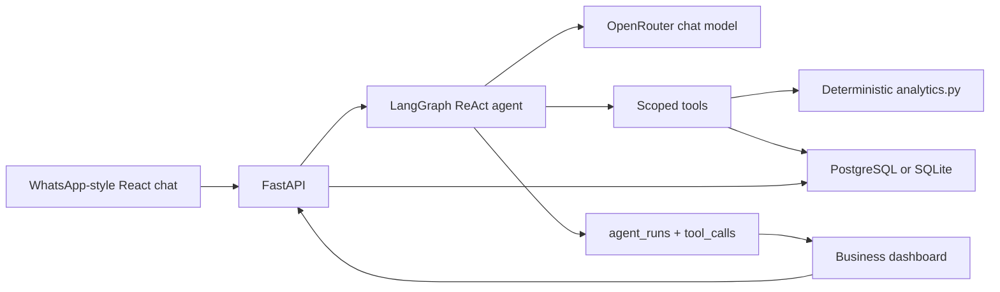

# Architecture

## Request path
1. The chat UI posts `{ user_id, conversation_id, message }` to `/api/chat`.
2. FastAPI stores the user message, bound to that `user_id`.
3. LangGraph runs a single ReAct loop with OpenRouter (`OPENROUTER_MODEL`, default `openai/gpt-4o-mini`).
4. Tools query or mutate only `Property.user_id == current user`.
5. Totals, shares, and yields are computed in Python.
6. The assistant message, timings, tool traces, and attention flags are stored and shown on the desk.

## Why this shape
- **One agent, one model.** The dataset is tiny; routing extra models would add latency and cost without a measured win.
- **SQL, not RAG.** Twelve properties and four users are relational facts. SQL plus typed tools is cheaper and safer than embeddings.
- **Calculations outside the LLM.** The assignment needs honest arithmetic and missing-price behaviour.
- **Hypotheticals as a separate tool.** Prevents accidental writes.
- **SQLite default, Postgres in Compose.** Local Windows can demo without Docker; Compose matches the recommended stack.

## Data isolation

Every portfolio tool is scoped to the current conversation's `user_id`. Read and write operations filter records by that user, preventing one user's portfolio from being accessed or modified through another user's conversation.

For example, P001 must not be modified while operating in Priya's U002 context. User scoping is enforced in backend tool logic rather than relying only on the model's instructions.

## Model availability and fallback

The agent uses the configured OpenRouter model when available. If a model request fails, the application can return a deterministic fallback response. Fallback responses are useful for basic availability but do not demonstrate successful real-model reasoning. Real-model evaluation and latency must therefore be measured separately.

## Memory
Postgres/SQLite holds the thread. Only the last `MAX_HISTORY_MESSAGES` (default 16) go to the model. Last mentioned property ids sit on the conversation row for follow-ups.
