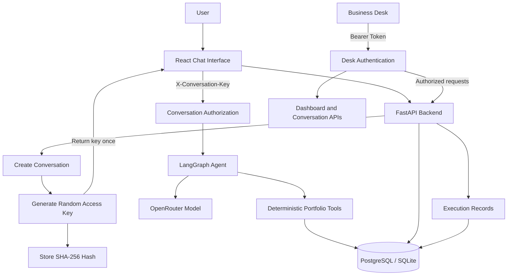

# Portfly — AI Real Estate Portfolio Analyst

**An AI-powered portfolio analysis application built with React, FastAPI, LangGraph, and PostgreSQL.**

[](https://portfly.onrender.com)
[](https://portfly.onrender.com/docs)
[](https://fastapi.tiangolo.com/)

| Resource | Link |
|---|---|
| Live application | [portfly.onrender.com](https://portfly.onrender.com) |
| Business Desk | [portfly.onrender.com/desk](https://portfly.onrender.com/desk) |
| API documentation | [Swagger UI](https://portfly.onrender.com/docs) |
| Source code | [GitHub Repository](https://github.com/Bhaveshcpp/Portfly) |

## 1. Project Overview

Portfly is a conversational AI application that helps property owners understand and analyze their real estate portfolios. Users can ask natural-language questions about property values, rental income, property performance, and hypothetical portfolio changes.

Instead of relying on a language model to calculate financial metrics directly, Portfly combines conversational AI with deterministic backend tools that retrieve property records and perform calculations using stored data.

The project also includes a Business Desk for inspecting conversations, execution metrics, errors, fallback activity, and conversations that require attention.

### Key Features

- **Portfolio analytics:** Calculate total property value, annual rental income, gross rental yield, occupancy, and property-type exposure.
- **Property search:** Find properties using portfolio information and supported filters.
- **Conversational analysis:** Ask questions in natural language and ask follow-up questions about previously discussed properties.
- **Property updates:** Add or update property records through supported backend operations.
- **What-if scenarios:** Explore hypothetical changes without persisting the hypothetical scenario as an actual portfolio update.
- **Conversation persistence:** Retain conversation history so users can continue conversations after refreshing the page.
- **Business Desk:** Inspect users, conversations, agent execution details, performance metrics, errors, and attention flags.
- **Access control:** Protect Business Desk endpoints with a server-configured Bearer token and authorize existing conversations using individual conversation access keys.
- **Model fallback:** Handle certain model inference failures through the application's fallback behavior.
- **Execution observability:** Record model timing, tool timing, token usage, errors, and fallback activity for supported agent runs.

## 2. Technology Stack

| Layer | Technologies |
|---|---|
| Frontend | React, Vite, JavaScript, Tailwind CSS |
| Backend | Python, FastAPI, REST APIs |
| Agent orchestration | LangChain / LangGraph |
| AI inference | OpenRouter API and configurable language models |
| Database and ORM | PostgreSQL, SQLite for local non-Docker configuration, SQLAlchemy |
| Deployment | Docker, Docker Compose, Render |
| Testing | pytest |

## 3. Architecture



*The diagram summarizes the principal components and security mechanisms. Individual routes have different authorization requirements, documented below.*

### Request Lifecycle

1. The user submits a question through the React interface.
2. FastAPI validates the request and identifies the user.
3. When a new conversation is created, the backend generates a cryptographically random access key.
4. The backend stores the key's SHA-256 hash and returns the plaintext key once.
5. For subsequent messages, the client supplies the conversation key through the `X-Conversation-Key` header.
6. The agent interprets the question and selects from its available tools when model inference is available.
7. Backend tools retrieve property records and calculate financial metrics.
8. The application returns the response and records relevant conversation and execution data.

### Why Deterministic Tools?

Language models are useful for interpreting questions, but they should not be the source of truth for financial arithmetic. Portfly delegates portfolio calculations to backend functions operating on stored property data. This makes calculations more consistent, inspectable, and testable.

## 4. Business Desk and Security

The Business Desk is available at `/desk`. Its administrative APIs use a shared server-configured `DESK_TOKEN`.

### Business Desk Authentication

Protected desk requests use:

```http
Authorization: Bearer <DESK_TOKEN>
```

The backend compares the supplied token against the configured server-side value.

- Missing or invalid credentials return HTTP 401.
- If `DESK_TOKEN` is not configured, protected desk endpoints fail closed with HTTP 503.
- The desk token is separate from conversation access keys.

### Per-Conversation Access Keys

Each new conversation receives an individual random access key.

- Only the SHA-256 hash is stored in the database.
- The plaintext key is returned when the conversation is created.
- The key is supplied through `X-Conversation-Key` when continuing an existing conversation or retrieving its chat history.
- A missing key returns HTTP 401.
- An invalid key or inaccessible conversation returns HTTP 403 with a generic error.
- Authorization is checked before a message is written to an existing conversation.
- Chat-history responses include `Cache-Control: no-store`.

The conversation key is a capability: anyone possessing the valid key can access that conversation through the operations authorized by the backend. It must be treated as a secret.

### Current Access-Control Scope

The current backend also exposes `GET /api/users` and `GET /api/users/{user_id}/properties` without the Business Desk token dependency. These routes should be restricted before using the application with sensitive production user or property data.

The Business Desk token and conversation keys protect their respective routes; they do not automatically secure every endpoint in the application.

## 5. Run Portfly Locally with Docker Compose

The recommended way to evaluate the complete application is Docker Compose. It starts PostgreSQL and the FastAPI service, builds the React frontend, and serves the built frontend through FastAPI.

### Prerequisites

Install:

- [Git](https://git-scm.com/downloads)
- [Docker Desktop](https://www.docker.com/products/docker-desktop/)
- An [OpenRouter API key](https://openrouter.ai/) for real-model inference

Docker Desktop must be running before you start the application.

### Step 1 — Clone the repository

```bash
git clone https://github.com/Bhaveshcpp/Portfly.git
cd Portfly
```

### Step 2 — Create the environment file

On Windows PowerShell:

```powershell
Copy-Item .env.example .env
```

Open `.env` and configure the following values:

```env
OPENROUTER_API_KEY=your_openrouter_api_key
OPENROUTER_MODEL=nvidia/nemotron-3-ultra-550b-a55b:free
OPENROUTER_BASE_URL=https://openrouter.ai/api/v1

DATABASE_URL=sqlite:///./portfly.db
MAX_HISTORY_MESSAGES=16

DESK_TOKEN=replace_with_a_long_random_secret
FRONTEND_ORIGIN=http://localhost:5173
```

Generate a strong desk token with Python:

```powershell
python -c "import secrets; print(secrets.token_urlsafe(32))"
```

Copy the generated value into `DESK_TOKEN`.

**Important configuration notes:**

- Replace the API-key placeholder with your own OpenRouter key.
- The model shown is the configured example model; provider availability and free-tier limits can change.
- The Docker Compose configuration overrides `DATABASE_URL` and connects the backend to its PostgreSQL service. The SQLite value in `.env.example` is for non-Docker local runs.
- `DESK_TOKEN` must be set for the protected Business Desk APIs to work.
- Keep `.env` private. Never commit API keys, database credentials, or the desk token.

### Step 3 — Build and start the application

From the project root:

```powershell
docker compose up --build -d
```

This builds the frontend, builds the backend image, starts PostgreSQL, and starts FastAPI after the database health check succeeds.

Check service status:

```powershell
docker compose ps
```

View backend logs:

```powershell
docker compose logs -f backend
```

Press `Ctrl+C` to stop following logs; this does not stop the containers.

### Step 4 — Open the application

| Service | Local URL |
|---|---|
| Main application | [http://localhost:8000](http://localhost:8000) |
| Business Desk | [http://localhost:8000/desk](http://localhost:8000/desk) |
| Health endpoint | [http://localhost:8000/api/health](http://localhost:8000/api/health) |
| API documentation | [http://localhost:8000/docs](http://localhost:8000/docs) |

The backend serves the compiled frontend from its static directory, so you do not need to start a separate Vite server for the Docker Compose setup.

### Step 5 — Verify the backend

Open:

```text
http://localhost:8000/api/health
```

The response includes an `ok` flag and an `openrouter` flag indicating whether an OpenRouter API key is configured.

An application that starts successfully does not necessarily have working model inference. If the key is missing, invalid, rate-limited, or the provider is unavailable, real-model responses may fail and fallback behavior may be used.

### Stop the application

```powershell
docker compose down
```

This stops the containers while preserving the PostgreSQL volume.

To delete the local PostgreSQL data as well, use the following only when you intentionally want to reset the local database:

```powershell
docker compose down -v
```

## 6. Using the Application

After the application starts, use the chat interface to explore the available seeded portfolio data.

Example questions include:

- "Show me my retail properties."
- "What is the total value of my portfolio?"
- "How much of my portfolio is retail?"
- "Which property has the highest rental income?"
- "Compare my residential and commercial properties."
- "What if I exclude one property from my portfolio?"
- "Update a property's value to a new amount."

The precise response depends on the available property data, the configured model, the tools supported by the current agent, and the request's validity.

For a property update, verify the resulting portfolio data afterward. For a hypothetical scenario, check that the scenario has not modified the persisted portfolio.

### Business Desk Workflow

1. Configure `DESK_TOKEN` before starting the backend.
2. Open `/desk`.
3. Use the configured token according to the Business Desk interface.
4. Inspect conversation activity, execution metrics, and conversations requiring attention.
5. Use the available resolution action for an attention flag when appropriate.

The protected desk APIs require the Bearer token even if the page itself loads. Do not share the token with users who should not have administrative access.

## 7. API Reference

The complete request and response schemas are available through [Swagger UI](https://portfly.onrender.com/docs) for the deployed application or `/docs` for a local instance.

| Endpoint | Purpose | Access control |
|---|---|---|
| `GET /api/health` | Backend health and API-key configuration status | Public |
| `GET /api/users` | List user records and summary counts | Currently public |
| `GET /api/users/{user_id}/properties` | List properties for a user | Currently public |
| `POST /api/chat` | Create a conversation or submit a message | Existing conversations require a conversation key |
| `GET /api/users/{user_id}/conversations/{conversation_id}/messages` | Retrieve chat history | Conversation access key |
| `GET /api/dashboard` | Dashboard metrics | Business Desk Bearer token |
| `GET /api/conversations` | List conversations | Business Desk Bearer token |
| `GET /api/conversations/{conversation_id}` | Conversation messages and execution details | Business Desk Bearer token |
| `POST /api/conversations/{conversation_id}/resolve` | Resolve a conversation attention flag | Business Desk Bearer token |

The deployed API documentation is the authoritative reference for the methods and schemas exposed by the running version.

## 8. Run Tests

The backend tests use pytest.

From the project root:

```powershell
cd backend
python -m venv .venv
.\.venv\Scripts\Activate.ps1
python -m pip install -r requirements.txt
python -m pytest -q
```

If PowerShell blocks virtual-environment activation, use the Python executable directly:

```powershell
.\.venv\Scripts\python.exe -m pip install -r requirements.txt
.\.venv\Scripts\python.exe -m pytest -q
```

The latest recorded local test run completed with **84 passed**. Rerun the suite on the version you are evaluating to verify the current result. Some dependency and agent API deprecation warnings were present.

## 9. AI Evaluation and Latency

Portfly has been evaluated using agent test cases and a separate real-model latency benchmark. Model evaluation and latency measurement are distinct: a request can fail because of provider availability even when the application code starts correctly.

### Latency Benchmark

The local Windows benchmark used SQLite and real OpenRouter calls.

- Configured model: `nvidia/nemotron-3-ultra-550b-a55b:free`
- Workload: 8 requests per repetition
- Repetitions: 5
- Successful turns: 25 out of 40
- Failed turns: 15 out of 40
- Failure cause: OpenRouter HTTP 429, free-model daily quota exhausted

Latency statistics below include successful turns only.

| Category | Successful turns | p50 total latency | p95 total latency |
|---|---:|---:|---:|
| All requests | 25 | 9.934 s | 24.013 s |
| Lookup | 7 | 7.133 s | 18.799 s |
| Analysis | 6 | 5.297 s | 16.098 s |
| Follow-up | 3 | 16.770 s | 24.013 s |
| What-if | 6 | 10.870 s | 26.619 s |
| Write/update | 3 | 6.148 s | 11.058 s |

### Where the Time Was Spent

| Metric | Result |
|---|---:|
| Median model time across successful turns | 9.865 s |
| Median tool execution time | 2 ms |
| Median other overhead | 84 ms |
| Average model calls per successful turn | 1.8 |
| Average prompt tokens per successful turn | 7,381 |
| Average completion tokens per successful turn | 345 |

Model inference and network latency dominate these measurements. The benchmark is a preliminary local baseline, not a production load test. The 15 quota-related failures were excluded from the latency statistics, so the figures should not be interpreted as an overall reliability percentage.

To rerun the benchmark, ensure the provider quota is available. From the `backend` directory:

```powershell
python -m scripts.measure_latency --reps 5 --warmup 0
```

The script writes `latency_results.json` in the current directory. Keep that generated output local unless there is a specific reason to publish it.

See [`docs/LATENCY.md`](docs/LATENCY.md) for the recorded baseline and measurement procedure.

## 10. Repository Structure

```text
Portfly/
├── backend/
│   ├── app/
│   │   ├── agent/          # Agent graph, prompts, and execution logic
│   │   ├── main.py         # FastAPI routes and access-control checks
│   │   ├── models.py       # SQLAlchemy models
│   │   ├── portfolio.py    # Portfolio operations
│   │   └── ...             # Configuration, tools, analytics, and database
│   ├── scripts/            # Evaluation and latency utilities
│   ├── tests/              # Backend tests
│   ├── requirements.txt
│   └── Dockerfile
├── frontend/               # React and Vite application
├── data/                   # Seed portfolio data
├── docs/
│   ├── LATENCY.md
│   └── WALKTHROUGH.md
├── .env.example
├── docker-compose.yml
├── SOUL.md                 # Agent behavior and operating instructions
├── ARCHITECTURE.md
├── DECISIONS.md
├── CHANGES.md
└── README.md
```

This is a high-level guide; consult the repository for the complete file list.

## 11. Known Limitations and Future Work

- Model responses depend on OpenRouter availability, provider rate limits, and model behavior.
- Fallback responses do not necessarily provide the same reasoning and tool-selection quality as successful model inference.
- The latency baseline is limited and needs to be repeated when the provider quota is available.
- Token costs should be calculated using verified prices for the configured model.
- The current public user and property listing endpoints should be protected before sensitive production data is used.
- Database persistence, authorization boundaries, and write operations should continue to receive dedicated integration and security testing.
- Existing dependency and agent API deprecation warnings should be addressed as part of maintenance.
- Observability, tool efficiency, and model selection can be improved using measured execution traces.

## 12. Additional Documentation

- [`SOUL.md`](SOUL.md) — Agent role, behavior, tools, uncertainty, and boundaries.
- [`ARCHITECTURE.md`](ARCHITECTURE.md) — Architecture and data flow.
- [`DECISIONS.md`](DECISIONS.md) — Design decisions and trade-offs.
- [`docs/WALKTHROUGH.md`](docs/WALKTHROUGH.md) — Project demonstration guide.
- [`docs/LATENCY.md`](docs/LATENCY.md) — Latency measurements and methodology.
- [`CHANGES.md`](CHANGES.md) — Project change log.

## License

No license is specified unless a license file is included in the repository. Contact the repository owner for reuse permissions.
